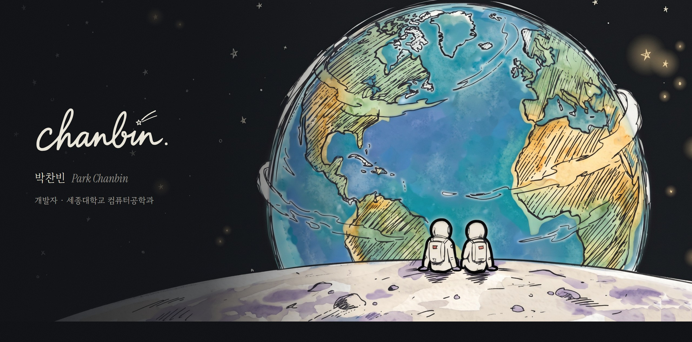
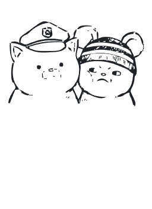

 

앱과 웹을 만드는 개발자입니다. 창업 팀에서는 서비스 개발뿐 아니라 기획, 운영, 홍보, 행사처럼 팀에 필요한 일들을 함께 하고 있습니다. 세종대 개발 동아리 그리디에서는 운영과 프로젝트 활동에 참여했습니다.

개발을 중심으로 시작했지만, 실제 사람들이 쓰는 서비스를 만들기 위해 개발 밖의 일에도 자연스럽게 참여하고 있습니다.

놀기도 좋아하고, 시간 나면 여행 갑니다.

[블로그](https://chanbin.dev) &nbsp;·&nbsp; [포트폴리오](https://portfolio.chanbin.dev) &nbsp;·&nbsp; [chanbin0626@gmail.com](mailto:chanbin0626@gmail.com)

<picture><source media="(prefers-color-scheme: dark)" srcset="assets/rule-dark.png"></picture>

### 만든 것 &nbsp;<i>Projects</i>

<picture><source media="(prefers-color-scheme: dark)" srcset="assets/p-cops-dark.png"></picture>
<b><a href="https://copsandrobbers.app/">경찰과 도둑</a></b> &nbsp;<code>2025.10 ~</code> &nbsp;출시 · 운영 중 
위치 기반 실시간 멀티플레이어 모바일 게임 
프론트엔드 (앱 · 웹) · <a href="https://apps.apple.com/kr/app/경찰과도둑/id6756843948">App Store</a> · <a href="https://play.google.com/store/apps/details?id=com.elipair.copsandrobbers">Google Play</a>

 

<picture><source media="(prefers-color-scheme: dark)" srcset="assets/p-allcll-dark.png"></picture>
<b><a href="https://allcll.kr">올클</a></b> &nbsp;<code>2025.12 ~</code> &nbsp;운영 중 
세종대학교 수강신청 도우미 
프론트엔드 · <a href="https://github.com/allcll/allcll-frontend">GitHub</a>

 

<picture><source media="(prefers-color-scheme: dark)" srcset="assets/p-gitmoru-dark.png"></picture>
<b><a href="https://gitmoru.dev">gitmoru</a></b> &nbsp;<code>2026.08 ~</code> &nbsp;npm 배포 · 운영 중 
저장소가 침해됐을 때 무엇이 바뀌었는지 확인하는 도구 
기획 · 개발 (개인) · <a href="https://www.npmjs.com/package/gitmoru">npm</a> · <a href="https://github.com/gitmoru/gitmoru">GitHub</a>

 

<picture><source media="(prefers-color-scheme: dark)" srcset="assets/p-footure-dark.png"></picture>
<b><a href="https://github.com/5sondoson/5sondoson-fe">Footure</a></b> &nbsp;<code>2026.03 ~</code> 
축구 선수 이적 퍼포먼스·시장가치 예측 서비스 
프론트엔드 · AI 추론 서버

 

<picture><source media="(prefers-color-scheme: dark)" srcset="assets/p-zupzup-dark.png"></picture>
<b><a href="https://github.com/greedy-team/zup-zup-fe">세종 줍줍</a></b> &nbsp;<code>2025.07 – 2026.04</code> 
세종대학교 지도 기반 분실물 찾기 웹 
프론트엔드 · 배포

 

<picture><source media="(prefers-color-scheme: dark)" srcset="assets/rule-dark.png"></picture>

### 활동 &nbsp;<i>Activities</i>

<b><a href="https://github.com/greedy-team">그리디</a></b> &nbsp;<code>2025.03 ~</code> 
세종대학교 SW 학술 동아리 
2기 멘티 → 3기 스터디 리드 → 4기 메인테이너

<b>그리디콘</b> &nbsp;<code>2026</code> 
SW중심대학사업단과 공동 주최한 현업 연사 초청 컨퍼런스 
운영진, 연사 섭외와 도서 후원 담당 · 100명 참가

<b>서울게임타운</b> &nbsp;<code>2026</code> 
인디게임 전시회 · 〈경찰과 도둑〉 부스 
참가 신청부터 부스 출품과 운영까지 직접 추진

<b>광진구 청춘대로</b> &nbsp;<code>2026</code> 
구청에 먼저 제안해 축제 공식 프로그램으로 편성 
기획안 작성, 장소와 시간 조율, 현장 프로그램 주관

<b>서울대학생연합페스티벌</b> &nbsp;<code>2026</code> 
세계관 부스와 미니운동회 〈경찰과 도둑〉 프로그램 
팀과 함께 기획 · 미니운동회 참가 50명

<b>노원 청소년축제 「행방불명」</b> &nbsp;<code>2026</code> 
'할로윈 밤, 도둑을 잡아라!' 부스 운영 
앱을 설치하지 않아도 먼저 해 볼 수 있는 체험을 앞단에 두는 방식을 처음 시험

<b>세종대 축제 부스</b> &nbsp;<code>2026</code> 
그리디 멤버들이 만든 게임으로 연 부스 
기획부터 현장 운영까지 총괄

<picture><source media="(prefers-color-scheme: dark)" srcset="assets/rule-dark.png"></picture>

### 수상 &nbsp;<i>Awards</i>

<code>2026</code> &nbsp;**세종 창업 아이디어리그 대상** · 경찰과 도둑 
<code>2026</code> &nbsp;**세종대학교 입주공모전 우수 창업 아이템상** · 경찰과 도둑 
<code>2026</code> &nbsp;**세종대학교 창업아이템 경진대회 우수상** · 경찰과 도둑 
<code>2026</code> &nbsp;**제14회 세종대학교 AI·SW 해커톤 우수상** · DevFlow 
<code>2026</code> &nbsp;**세종대학교 전공심화학습공동체 장려상** · Footure 
<code>2025</code> &nbsp;**제13회 세종대학교 SW·AI 해커톤 장려상** · 깃력사무소

<picture><source media="(prefers-color-scheme: dark)" srcset="assets/rule-dark.png"></picture>

### 최근 글 &nbsp;<i>Posts</i>

<!-- POSTS:START -->
[공부 플래너 앱의 Google Calendar API 권한 심사 좌충우돌기](https://chanbin.dev/posts/haruchi-google-calendar-oauth-review) &nbsp;<code>2026.10.19</code> 
[경찰과 도둑 앱 LLM 지표 챗봇의 숫자를 코드로 계산하기](https://chanbin.dev/posts/cheddar-metrics-chatbot) &nbsp;<code>2026.10.15</code> 
[Supabase로 경찰과 도둑 앱 지표 대시보드 만들기](https://chanbin.dev/posts/metrics-dashboard-7-admin-dashboard) &nbsp;<code>2026.10.13</code> 
[AdMob API 갱신 토큰으로 경찰과 도둑 앱 광고 지표 매일 받기](https://chanbin.dev/posts/metrics-dashboard-6-admob-oauth) &nbsp;<code>2026.10.11</code> 
[GA4 Data API로 경찰과 도둑 앱과 웹사이트 지표 모으기](https://chanbin.dev/posts/metrics-dashboard-5-ga4-data-api) &nbsp;<code>2026.10.10</code>
<!-- POSTS:END -->

 

<a href="https://chanbin.dev"><picture><source media="(prefers-color-scheme: dark)" srcset="assets/foot-dark.png"></picture></a> <a href="https://chanbin.dev">chanbin.dev</a>

